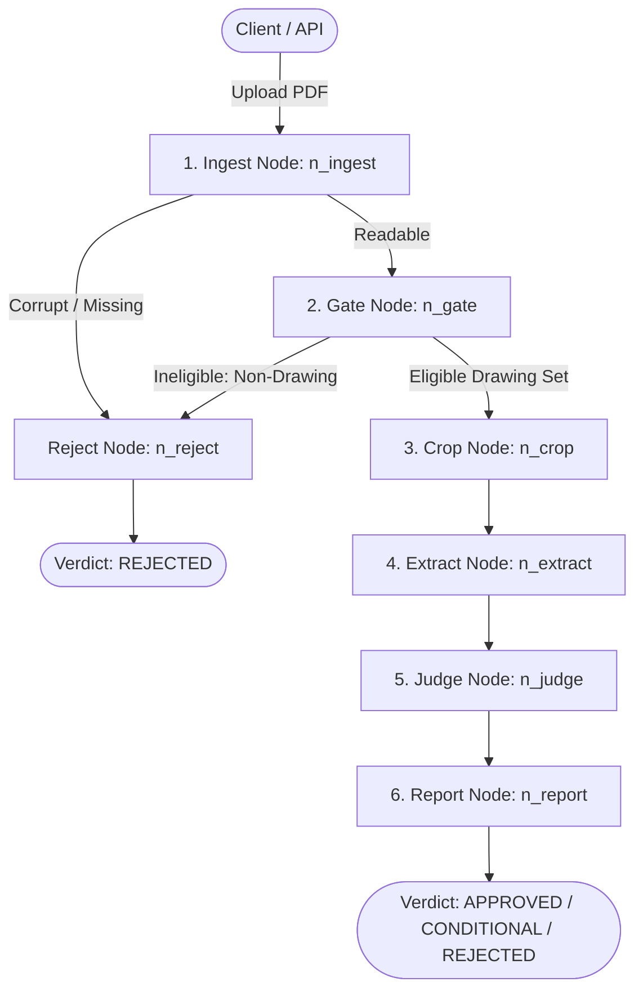

# 🏛️ House Scrutiny AI — Backend Technical Documentation

This document describes the internal engineering architecture and file breakdown of the **House Scrutiny AI Backend Service**.

For the complete monorepo technical specification including the Next.js 16 frontend and evaluation frameworks, see the root [`docs.md`](../docs.md).

---

## 1. The 7-Step LangGraph Scrutiny Flow

The core scrutiny engine is a state machine defined in [`src/pipeline/graph.py`](src/pipeline/graph.py) and [`src/pipeline/nodes.py`](src/pipeline/nodes.py) operating on the shared state TypedDict `S` from [`src/config/schemas.py`](src/config/schemas.py):

1. **`ingest` ([`n_ingest`](src/pipeline/nodes.py))**:
   - Opens the PDF using PyMuPDF (`fitz`).
   - Extracts raw text, font structures, and embedded CAD vector geometry (lines, rectangles, polylines, bezier curves).
   - Scrubs prompt injection or adversarial invisible text (white text, tiny fonts).
   - Generates perceptual and hash fingerprints to detect duplicate sheets.
   - If encrypted, empty, or unreadable, branches directly to `reject`.
2. **`gate` ([`n_gate`](src/pipeline/nodes.py))**:
   - Evaluates whether the uploaded file is actually an architectural drawing package or an irrelevant document (resume, invoice, text document).
   - Saves expensive vision tokens by filtering out ineligible files early.
3. **`reject` ([`n_reject`](src/pipeline/nodes.py))**:
   - Formulates a standardized rejection verdict explaining why the document failed eligibility/readability.
4. **`crop` ([`n_crop`](src/pipeline/nodes.py))**:
   - Uses intelligent region-of-interest (ROI) selectors to crop critical drawing sections: Title Blocks, Floor Plans, Setback Dimlines, Elevation Schedules, and Notes.
   - Generates high-DPI base64 visual crops.
5. **`extract` ([`n_extract`](src/pipeline/nodes.py))**:
   - Sends cropped drawing regions and CAD cues to the multimodal vision LLM (OpenAI GPT-4o / active model).
   - Validates output into strict Pydantic schemas: plot dimensions, setbacks (front, rear, sides), total height, storeys, covered area percentage, rebar notes, and stability certificates.
6. **`judge` ([`n_judge`](src/pipeline/nodes.py))**:
   - Runs bylaw rule checkers against the statutory requirements of the specified authority (e.g. DHA Lahore rules).
   - Cross-checks extracted measurements against mandatory bylaws (e.g., minimum 10 ft front setback, maximum height 35 ft).
   - Resolves conflicts between floor plans and section elevations.
7. **`report` ([`n_report`](src/pipeline/nodes.py))**:
   - Aggregates compliance findings into an executive verdict (`APPROVED`, `REJECTED`, or `CONDITIONAL`).
   - Builds an evidence chain connecting each rule to exact visual bounding box coordinates.
   - Persists state into Neon PostgreSQL and caches thread summary in Redis.

---

## 2. Complete File & Directory Breakdown

### ⚙️ Root Files & Config
- **[`app.py`](app.py)**: The FastAPI application entrypoint. Configures CORS, lifecycle hooks (runs Alembic migrations, seeds AI models catalog, connects to Redis), request logging middleware, health probes, and mounts API routers.
- **[`bylaw.json`](bylaw.json)**: Statutory municipal bylaw parameters (plot sizes from 5 Marla to 2 Kanal, commercial/residential setback rules, height limits, ground coverage percentages).
- **[`requirements.txt`](requirements.txt)**: Python dependencies including FastAPI, LangGraph, PyMuPDF, ReportLab, SQLAlchemy, psycopg2, redis, and openai.
- **[`pdf_generator.py`](pdf_generator.py)**: Standalone CLI trigger for testing the PDF audit certificate generation.
- **[`alembic.ini`](alembic.ini) & [`alembic/`](alembic/)**: Database migration configurations and schema revision scripts for Neon PostgreSQL.

### 🌐 `src/api/` — Web API Layer
- **[`src/api/schemas.py`](src/api/schemas.py)**: Pydantic input/output request models (chat messages, approval requests, model configurations).
- **[`src/api/common.py`](src/api/common.py)**: Shared utility helpers for file validation, tempfile buffering, and execution wrappers.
- **`src/api/routers/`**:
  - **[`scrutinize.py`](src/api/routers/scrutinize.py)**:
    - `POST /api/v1/scrutinize`: Synchronous file upload scrutiny.
    - `POST /api/v1/scrutinize/stream`: SSE real-time event streaming of node milestones with Human-in-the-Loop (HITL) cancellation (`request.is_disconnected()` check).
    - `POST /api/v1/scrutinize/package`: Multi-file drawing package merger and audit.
  - **[`threads.py`](src/api/routers/threads.py)**: Thread management and follow-up interactive chat (`POST /api/v1/threads/{id}/chat`) with streaming SSE responses.
  - **[`cases.py`](src/api/routers/cases.py)**: Human reviewer/engineer case management, approval overrides, and audit case lookup.
  - **[`models.py`](src/api/routers/models.py)**: Multimodal AI model catalog, custom model registration, and dynamic model switching.
  - **[`reports.py`](src/api/routers/reports.py)**: Endpoints to query bylaws and download generated official compliance PDF certificates.

### 🧠 `src/pipeline/` — LangGraph Orchestration
- **[`src/pipeline/graph.py`](src/pipeline/graph.py)**: Defines the StateGraph, attaches the 7 execution nodes, sets conditional routing edges, and compiles with PostgreSQL checkpointer support.
- **[`src/pipeline/nodes.py`](src/pipeline/nodes.py)**: Implements the exact execution logic of each individual node (`n_ingest`, `n_gate`, `n_reject`, `n_crop`, `n_extract`, `n_judge`, `n_report`).

### 👁️ `src/vision/` — CAD & Multi-Resolution Vision
- **[`src/vision/crop_selector.py`](src/vision/crop_selector.py)**: Analyzes text density and bounding boxes to identify regions of interest (title block, setbacks, notes) and generates high-res crop coordinates.
- **[`src/vision/extractor.py`](src/vision/extractor.py)**: Batches cropped images, constructs structured multimodal prompts, calls the LLM, and parses responses into typed Extraction models.
- **[`src/vision/title_block.py`](src/vision/title_block.py)**: Specialized heuristics to extract drawing sheet metadata (Plot No, Architect PEC Reg, Sheet Title, Revision Date).

### ⚖️ `src/auditors/` — Compliance & Verification Logic
- **[`src/auditors/bylaw_auditor.py`](src/auditors/bylaw_auditor.py)**: Compares extracted numerical values (setbacks, height, covered area) with municipal rules.
- **[`src/auditors/sheet_auditor.py`](src/auditors/sheet_auditor.py)**: Verifies required sheet annotations (dimension lines, North arrow, scale bar, grid lines).
- **[`src/auditors/completeness_model.py`](src/auditors/completeness_model.py)**: Checks package completeness (ensures Architectural, Structural, and MEP drawings are all present).
- **[`src/auditors/conflict_resolver.py`](src/auditors/conflict_resolver.py)**: Cross-compares floor plan measurements against elevation and section dimensions to catch discrepancies.
- **[`src/auditors/evidence_verifier.py`](src/auditors/evidence_verifier.py)**: Validates visual evidence grounding (ensures bounding boxes correspond to actual content on the page to prevent hallucination).
- **[`src/auditors/revision_auditor.py`](src/auditors/revision_auditor.py)**: Tracks drawing revision numbers and identifies modified clouds between revision submissions.

### 🛠️ `src/core/` — Document Processing & System Core
- **[`src/core/pdf_parser.py`](src/core/pdf_parser.py)**: PyMuPDF low-level engine to extract text spans, vector geometry paths, and render pages to PNG.
- **[`src/core/security.py`](src/core/security.py)**: Detects and scrubs prompt injection payloads, invisible white text, and malicious embedded instructions.
- **[`src/core/orientation.py`](src/core/orientation.py)**: Detects page orientation (portrait, landscape, upside-down) and normalizes rotations.
- **[`src/core/duplicates.py`](src/core/duplicates.py)**: Detects redundant or identical sheets across large drawing sets.
- **[`src/core/case_store.py`](src/core/case_store.py)**: Manages scrutiny case files on disk/database for engineer review.
- **[`src/core/client.py`](src/core/client.py)**: Centralized OpenAI API client initialization with timeout and retry configuration.

### 💾 `src/memory/` — Caching & Persistence
- **[`src/memory/database.py`](src/memory/database.py)**: Neon PostgreSQL connection pooling, engine initialization, and automatic startup migration triggers.
- **[`src/memory/cache.py`](src/memory/cache.py)**: Redis key-value cache layer with fallback to in-memory/DB.
- **[`src/memory/short_term.py`](src/memory/short_term.py)**: LangGraph PostgresSaver checkpointer for thread-scoped node transitions and state recovery.
- **[`src/memory/long_term.py`](src/memory/long_term.py)**: Cross-thread submission history, chat message persistence, and audit logging.
- **[`src/memory/models_store.py`](src/memory/models_store.py)**: Database storage for registered AI vision models and active model selection.

### ⚙️ `src/config/` — Settings, Prompts & Data Types
- **[`src/config/settings.py`](src/config/settings.py)**: Reads environment variables (.env) for DB URLs, Redis URLs, OpenAI API keys, and CORS settings.
- **[`src/config/schemas.py`](src/config/schemas.py)**: Contains TypedDict `S` and Pydantic data models for extracted values and checklist observations.
- **[`src/config/prompts.py`](src/config/prompts.py)**: System prompts for drawing classification, vision extraction, and interactive auditor chat.
- **[`src/config/bylaws.py`](src/config/bylaws.py)**: Hardcoded and JSON-loaded bylaw definitions across different housing societies.
- **[`src/config/checklists.py`](src/config/checklists.py)**: Standard audit checklist specifications (title block, engineer stamp, setbacks, septic tank details, etc.).

### 📄 `src/reporting/` — PDF Report Generator
- **[`src/reporting/pdf_report.py`](src/reporting/pdf_report.py)**: Production ReportLab vector PDF generator. Compiles an official multi-page Scrutiny Audit Certificate containing society header branding, executive verdict, violation tables, and visual evidence crops.
