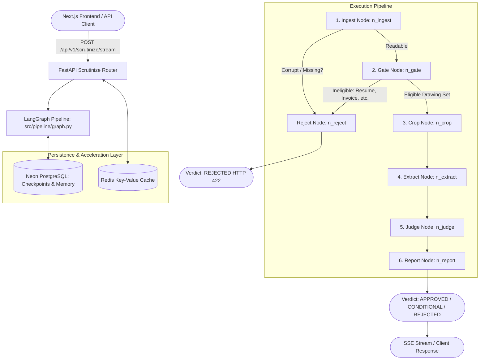
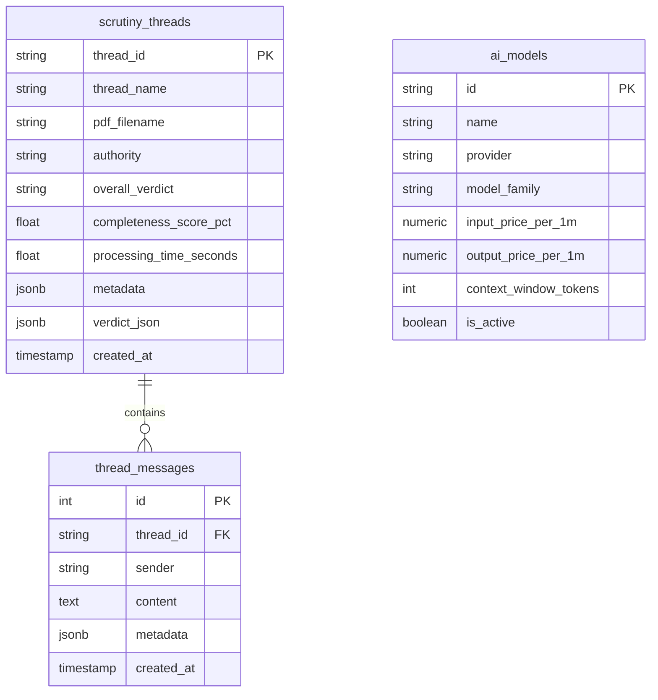

# 🏛️ House Scrutiny AI — Architecture & Technical Documentation

An enterprise-grade, autonomous building-control map scrutiny and structural drawing verification platform. It inspects submitted architectural blueprints, structural engineering drawings, and stability certificates against municipal bylaws and civil engineering standards.

---

## Table of Contents
1. [System Overview & Key Capabilities](#1-system-overview--key-capabilities)
2. [Monorepo Architecture & Technology Stack](#2-monorepo-architecture--technology-stack)
3. [End-to-End Request Flow & Pipeline Diagram](#3-end-to-end-request-flow--pipeline-diagram)
4. [The 7-Step LangGraph Scrutiny Flow](#4-the-7-step-langgraph-scrutiny-flow)
   - [LangGraph Shared State Schema (TypedDict S)](#langgraph-shared-state-schema-typeddict-s)
   - [Step 1: n_ingest (CAD Vector & Layer Parsing)](#step-1-n_ingest-cad-vector--layer-parsing)
   - [Step 2: n_gate (TypeSafe Jev Page Eligibility)](#step-2-n_gate-typesafe-jev-page-eligibility)
   - [Step 3: n_reject (Terminal Rejection & Diagnostic Exit)](#step-3-n_reject-terminal-rejection--diagnostic-exit)
   - [Step 4: n_crop (Intelligent Focal Zone Cropping)](#step-4-n_crop-intelligent-focal-zone-cropping)
   - [Step 5: n_extract (Multi-Resolution Vision Extraction)](#step-5-n_extract-multi-resolution-vision-extraction)
   - [Step 6: n_judge (Multi-Tier Bylaw & Rule Auditor)](#step-6-n_judge-multi-tier-bylaw--rule-auditor)
   - [Step 7: n_report (Verdict Assembly & Token Accounting)](#step-7-n_report-verdict-assembly--token-accounting)
5. [Complete Backend File & Directory Breakdown](#5-complete-backend-file--directory-breakdown)
   - [Root Files & Operational Scripts](#root-files--operational-scripts)
   - [src/api/ — Web API Layer & Streaming](#srcapi--web-api-layer--streaming)
   - [src/pipeline/ — LangGraph Orchestration](#srcpipeline--langgraph-orchestration)
   - [src/vision/ — CAD & Multi-Resolution Vision](#srcvision--cad--multi-resolution-vision)
   - [src/auditors/ — Compliance & Verification Logic](#srcauditors--compliance--verification-logic)
   - [src/core/ — Document Processing & System Core](#srccore--document-processing--system-core)
   - [src/memory/ — Caching & Persistence](#srcmemory--caching--persistence)
   - [src/config/ — Settings, Prompts & Data Types](#srcconfig--settings-prompts--data-types)
   - [src/reporting/ — PDF Report Generator](#srcreporting--pdf-report-generator)
6. [Human-in-the-Loop (HITL) Stream Cancellation](#6-human-in-the-loop-hitl-stream-cancellation)
7. [Frontend Architecture (Next.js 16 + TanStack Query)](#7-frontend-architecture-nextjs-16--tanstack-query)
   - [TanStack React Query v5 State Layer](#tanstack-react-query-v5-state-layer)
   - [URL-Driven Thread State (?thread_id=...)](#url-driven-thread-state-thread_id)
   - [Real-Time SSE Streaming Chat](#real-time-sse-streaming-chat)
8. [Dual-Tier Memory & Redis Caching Layer](#8-dual-tier-memory--redis-caching-layer)
   - [Redis Keyvalue Cache Design & Fail-Safe Fallback](#redis-keyvalue-cache-design--fail-safe-fallback)
   - [TTL Policy & Invalidation Triggers](#ttl-policy--invalidation-triggers)
   - [Startup Logging & Connection Verification](#startup-logging--connection-verification)
9. [Database & Alembic Migration Engine](#9-database--alembic-migration-engine)
   - [Database Tables Schema](#database-tables-schema)
   - [Lifespan Auto-Migration Hook](#lifespan-auto-migration-hook)
10. [Multimodal Model Switcher & Catalog](#10-multimodal-model-switcher--catalog)
11. [REST API Reference](#11-rest-api-reference)
12. [Automated Testing & DeepEval Framework](#12-automated-testing--deepeval-framework)
13. [Security & Anti-Injection Hardening](#13-security--anti-injection-hardening)

---

## 1. System Overview & Key Capabilities

House Scrutiny AI automates the end-to-end technical scrutiny of multi-sheet drawing packages submitted to municipal housing societies and development authorities (e.g., **CDA Islamabad**, **DHA Lahore**, **LDA**, **Bahria Town**, and **OPF Islamabad**).

### Core Capabilities:
- **Vector & Raster PDF Ingestion**: Extracts digital text, font metrics, annotations, vector CAD line geometry (polylines, rectangles, bezier curves), and OCG layers.
- **Fast Rejection Gating**: Uses TypeSafe Jev decision classification to instantly reject non-engineering files (invoices, resumes, contracts) with zero expensive vision token spend.
- **Intelligent Focus Cropping**: Generates high-detail crops of critical zones (title blocks, revision tables, dimension clusters, scale bars) while keeping full-page low-detail overviews.
- **Isolated Multi-Pass Extraction**: Queries multimodal vision models in three segregated batches (Architectural, Structural, and Certificate) to avoid cross-contamination of values.
- **Multi-Tier Evidence Verification**: Re-checks AI vision claims against spatial CAD text coordinates and OCR data to eliminate hallucinations.
- **Cross-Page Conflict & Revision Audit**: Resolves conflicting numbers across sheets and prioritizes the authoritative master revision.
- **Bylaw Compliance Engine**: Programmatically enforces setbacks, ground coverage, maximum height, FAR, cantilever projections, and basement rules for specific plot sizes.
- **Signed Vector PDF Reports**: Produces instant on-screen verdicts and downloadable signed ReportLab PDF audit reports.
- **Human-in-the-Loop (HITL) Stream Cancellation**: Allows instantaneous termination of LLM inference when the user aborts an SSE stream.

---

## 2. Monorepo Architecture & Technology Stack

The project is structured as a high-performance monorepo:

```text
house-securinity/
├── frontend/                   # Next.js 16, React 19, Tailwind CSS 4, TanStack Query
└── backend/                    # FastAPI 2.0, LangGraph, Neon PostgreSQL, Redis, PyMuPDF
```

### Technology Matrix:
| Domain | Technology | Purpose |
| :--- | :--- | :--- |
| **Frontend Framework** | Next.js 16 (App Router) + React 19 | Responsive server/client rendering |
| **Client State / Cache** | TanStack React Query v5 | Instant UI updates, query caching & refetching |
| **Styling & UI** | Tailwind CSS 4, Radix UI, Lucide Icons | Glassmorphic dark engineering UI |
| **Backend REST API** | FastAPI 2.0 + Pydantic v2 | High-throughput asynchronous REST endpoints |
| **Pipeline Orchestration**| LangGraph StateGraph | Deterministic multi-node state machine with checkpointing |
| **Decision Gating** | TypeSafe System One (Jev) | Calibrated sheet classification & eligibility |
| **Vision Extraction** | OpenAI GPT-4o / Claude / Gemini | High-resolution multimodal parameter extraction |
| **CAD Parsing** | PyMuPDF (fitz) | Vector geometry, layers, coordinate extraction |
| **Primary Database** | Neon PostgreSQL (Serverless) | Persistent thread audits, messages & model catalog |
| **Database Migrations**| Alembic | Production-grade version-controlled migrations |
| **Speed Cache Layer** | Redis Keyvalue (Render / Cloud) | In-memory cache-aside for sub-millisecond retrieval |
| **PDF Reporting** | ReportLab Vector Engine | Printable official engineering audit reports |

---

## 3. End-to-End Request Flow & Pipeline Diagram



---

## 4. The 7-Step LangGraph Scrutiny Flow

The core engine is a state machine defined in [`backend/src/pipeline/graph.py`](backend/src/pipeline/graph.py) and [`backend/src/pipeline/nodes.py`](backend/src/pipeline/nodes.py). All nodes operate on a shared state TypedDict `S`.

### LangGraph Shared State Schema (TypedDict `S`)
Defined in [`backend/src/config/schemas.py`](backend/src/config/schemas.py):
```python
class S(TypedDict, total=False):
    pdf: str                     # Filepath to the input PDF
    authority: str | None        # Target authority / society (DHA_Lahore, CDA_Islamabad, etc.)
    pages: list                  # Page-by-page extracted data (text, annots, hidden text, hints)
    meta: dict                   # PDF document metadata (Creator, CreationDate, etc.)
    embedded: list               # Embedded attachments
    layers: list                 # Vector CAD & OCG layers (rebar, beams, columns)
    flags: list                  # System flags (unreadable, warnings)
    unreadable: bool             # Flag indicating file is unreadable / corrupt
    doc_type: dict               # Classification result from TypeSafe Jev
    document_eligibility: str    # ELIGIBLE, UNSUPPORTED_DOCUMENT, CLASSIFICATION_UNAVAILABLE
    shots: list                  # High-DPI rendered crops sent to vision LLM
    page_coverage: dict          # Page coverage tracking (page 1..N metrics)
    security_audit: list         # Prompt injection & scrubbed anomalies
    cad_geometry: dict           # True vector CAD drawing paths (lines, rects, curves)
    revisions_audit: dict        # Cross-sheet revision history and delta audit
    evidence_chain: dict         # Traceable links: requirement -> evidence -> bbox -> decision
    duplicates_audit: dict       # Multi-signal duplicate sheet detection
    extraction: dict             # Parsed JSON from multimodal vision model
    checks: dict                 # Judgments per checklist item
    verdict: dict                # Final compiled audit report and compliance status
    token_usage: dict            # Aggregated token metrics and pricing cost
    active_model: str | None     # Active vision model ID (e.g. gpt-4o, claude-3-5-sonnet)
```

---

### Step 1: `n_ingest` (CAD Vector & Layer Parsing)
- **File & Function**: [`src/pipeline/nodes.py:n_ingest`](backend/src/pipeline/nodes.py)
- **Role**: Validates, unpacks, and performs security screening on the submitted PDF.
- **Key Operations**:
  1. Opens the PDF using PyMuPDF (`fitz`).
  2. Extracts raw digital text, font metrics, and embedded CAD vector geometry (lines, rectangles, polylines, and bezier curves).
  3. Scrubs prompt injection attempts and adversarial invisible text (zero-size fonts, white-on-white text layers) via `src.core.security.scrub`.
  4. Generates perceptual visual hashes and geometry hashes across all pages via `src.core.duplicates` to flag duplicated sheets.
  5. Inspects document accessibility: if encrypted, password-protected, corrupt, or containing zero text/images/vectors, sets `unreadable = True`.
- **Branching Decision**:
  - If `unreadable == True` ➔ jumps directly to `n_reject`.
  - If valid ➔ advances to `n_gate`.

---

### Step 2: `n_gate` (TypeSafe Jev Page Eligibility)
- **File & Function**: [`src/pipeline/nodes.py:n_gate`](backend/src/pipeline/nodes.py)
- **Role**: Validates whether the document represents an eligible architectural or structural drawing package.
- **Key Operations**:
  1. Evaluates text signals, page aspect ratios, drawing title blocks, and CAD layer density.
  2. Uses TypeSafe System One classification to classify each sheet into categories:
     - `ARCHITECTURAL_PLAN`, `STRUCTURAL_DRAWING`, `STABILITY_CERTIFICATE`, or `NON_ENGINEERING`.
  3. Detects non-engineering documents (invoices, resumes, bank guarantees, tax certificates).
- **Branching Decision**:
  - If `document_eligibility != "ELIGIBLE"` ➔ routes to `n_reject` (saving 100% of expensive downstream vision tokens).
  - If `document_eligibility == "ELIGIBLE"` ➔ advances to `n_crop`.

---

### Step 3: `n_reject` (Terminal Rejection & Diagnostic Exit)
- **File & Function**: [`src/pipeline/nodes.py:n_reject`](backend/src/pipeline/nodes.py)
- **Role**: Formulates a standardized rejection diagnosis explaining why the submission was declined.
- **Key Operations**:
  1. Compiles specific rejection reasons (e.g. "Missing floor plans", "Encrypted document", "Non-engineering file detected: Resume/Invoice").
  2. Sets overall verdict to `REJECTED`, assigns a completeness score of `0.0%`, and compiles actionable submission guidance for the architect.
  3. Routes directly to `END`, returning an HTTP 422 Unprocessable Entity response.

---

### Step 4: `n_crop` (Intelligent Focal Zone Cropping)
- **File & Function**: [`src/pipeline/nodes.py:n_crop`](backend/src/pipeline/nodes.py)
- **Role**: Uses spatial heuristics to extract high-resolution focal crops from large architectural blueprints.
- **Key Operations**:
  1. Analyzes spatial density and bounding boxes via [`src/vision/crop_selector.py`](backend/src/vision/crop_selector.py).
  2. Isolates key regions of interest (ROIs):
     - **Title Block**: Project name, client, architect/engineer PEC registration, scale, date, revision stamp.
     - **Dimension Clusters**: Front, rear, and side setback dimensions, plot boundary lines, room dimensions.
     - **Elevation & Section Schedules**: Total building height, floor-to-floor heights, plinth levels, parapet walls.
     - **Structural Notes & Schedules**: Concrete grade (psi), steel rebar grade (psi), column schedules, slab thickness.
  3. Converts crops to high-DPI base64 image strings ready for multimodal model ingestion.

---

### Step 5: `n_extract` (Multi-Resolution Vision Extraction)
- **File & Function**: [`src/pipeline/nodes.py:n_extract`](backend/src/pipeline/nodes.py)
- **Role**: Executes multimodal vision extraction using OpenAI GPT-4o (or the active model selected).
- **Key Operations**:
  1. Submits cropped drawing zones and full-sheet context to the multimodal model.
  2. Executes three segregated extraction passes:
     - **Architectural Pass**: Setbacks (ft), plot area (marla/sq ft), ground coverage %, total building height (ft), storeys, plinth height, boundary wall height.
     - **Structural Pass**: Slab thickness (in), foundation depth (ft), concrete grade (psi), steel grade (psi), column/beam schedules presence.
     - **Certificate Pass**: Stability certificate issuance date, consulting engineer signature, PEC number, plot reference.
  3. Validates and parses the raw model response into typed Pydantic structures (`Extraction`, `Val`, `StructVal`, `StabilityCertData`).

---

### Step 6: `n_judge` (Multi-Tier Bylaw & Rule Auditor)
- **File & Function**: [`src/pipeline/nodes.py:n_judge`](backend/src/pipeline/nodes.py)
- **Role**: Audits extracted parameters against statutory municipal bylaws and resolves discrepancies.
- **Key Operations**:
  1. Loads statutory limits for the selected authority (DHA Lahore, CDA Islamabad, LDA, etc.) from [`backend/bylaw.json`](backend/bylaw.json) and [`backend/src/config/bylaws.py`](backend/src/config/bylaws.py).
  2. Evaluates compliance rules:
     - Front, rear, left, and right setbacks (e.g. minimum 10 ft front setback for 1 Kanal).
     - Maximum permissible height and storey limits.
     - Maximum ground coverage ratio (e.g. max 65% for residential).
     - Underground and overhead water tank capacity requirements.
  3. Resolves cross-sheet conflicts via [`src/auditors/conflict_resolver.py`](backend/src/auditors/conflict_resolver.py).
  4. Verifies visual grounding via [`src/auditors/evidence_verifier.py`](backend/src/auditors/evidence_verifier.py) to eliminate AI hallucinations.

---

### Step 7: `n_report` (Verdict Assembly & Token Accounting)
- **File & Function**: [`src/pipeline/nodes.py:n_report`](backend/src/pipeline/nodes.py)
- **Role**: Synthesizes final verdict, aggregates evidence chains, calculates processing costs, and writes persistent records.
- **Key Operations**:
  1. Determines the overarching status:
     - `APPROVED`: 100% compliance across all mandatory checklist items.
     - `APPROVED_WITH_CONDITIONS`: Minor non-structural deviations requiring field rectification.
     - `REJECTED`: Major structural or statutory bylaw violations.
  2. Calculates token usage and processing costs based on model catalog pricing.
  3. Assembles the traceable evidence chain linking each requirement to its bounding box coordinates on specific sheet pages.
  4. Persists the scrutiny record into Neon PostgreSQL (`scrutinize_threads` table) and invalidates Redis cache keys (`hs:threads:list`).

---

## 5. Complete Backend File & Directory Breakdown

```text
backend/
├── app.py                      # FastAPI application entrypoint & lifespan hooks
├── bylaw.json                  # Statutory municipal bylaw parameters
├── requirements.txt            # Python dependencies
├── pdf_generator.py            # Standalone PDF generation test script
├── alembic.ini & alembic/      # Database migrations config & revisions
└── src/
    ├── api/                    # Modular REST API routers and schemas
    ├── pipeline/               # LangGraph state machine & nodes
    ├── vision/                 # CAD crop selector & multimodal extraction
    ├── auditors/               # Statutory bylaw and technical auditors
    ├── core/                   # PDF parsing, security scrubbing & case store
    ├── memory/                 # Database, Redis caching, short/long-term memory
    ├── config/                 # Pydantic settings, schemas, prompts & checklists
    └── reporting/              # Vector PDF compliance report generator
```

### Root Files & Operational Scripts
- **[`backend/app.py`](backend/app.py)**: The FastAPI main application entrypoint. Configures CORS, sets up structured logging, defines health check routes (`/health`), and orchestrates startup `lifespan` events (auto-running Alembic migrations, seeding AI models catalog, verifying Redis cache connectivity).
- **[`backend/bylaw.json`](backend/bylaw.json)**: Machine-readable municipal bylaw database containing plot categories (5 Marla, 10 Marla, 1 Kanal, 2 Kanal, Commercial), mandatory setbacks, maximum building heights, and allowable ground coverage percentages.
- **[`backend/requirements.txt`](backend/requirements.txt)**: Core backend dependencies: `fastapi`, `uvicorn`, `langgraph`, `pymupdf` (fitz), `openai`, `reportlab`, `sqlalchemy`, `psycopg2-binary`, `redis`, `pydantic-settings`, and `deepeval`.
- **[`backend/pdf_generator.py`](backend/pdf_generator.py)**: Standalone CLI utility to test and render ReportLab audit compliance certificates without running the entire web server.
- **[`backend/alembic.ini`](backend/alembic.ini)** & **[`backend/alembic/`](backend/alembic/)**: Database migration environment and revision files (`001_initial_schema.py`) managing schema lifecycles for Neon PostgreSQL.

---

### `src/api/` — Web API Layer & Streaming
- **[`src/api/schemas.py`](backend/src/api/schemas.py)**: Typed Pydantic request and response models (e.g. `ChatMessageRequest`, `ModelCreateRequest`, `ReviewCaseApproval`).
- **[`src/api/common.py`](backend/src/api/common.py)**: Shared API utility helpers for PDF file validation, temporary file buffering, execution wrappers, and error handling.
- **`src/api/routers/`**:
  - **[`scrutinize.py`](backend/src/api/routers/scrutinize.py)**:
    - `POST /api/v1/scrutinize`: Synchronous drawing package scrutiny.
    - `POST /api/v1/scrutinize/stream`: Real-time Server-Sent Events (SSE) streaming of LangGraph node milestones with Human-in-the-Loop (HITL) cancellation.
    - `POST /api/v1/scrutinize/package`: Multi-file drawing package merger and audit.
  - **[`threads.py`](backend/src/api/routers/threads.py)**: Thread persistence (`GET /api/v1/threads`), individual audit retrieval (`GET /api/v1/threads/{id}`), deletion (`DELETE /api/v1/threads/{id}`), and real-time streaming conversational assistant (`POST /api/v1/threads/{id}/chat`) with token-by-token streaming and disconnect detection.
  - **[`cases.py`](backend/src/api/routers/cases.py)**: Human reviewer / civil engineer case management, manual approval overrides, and drawing evidence page rendering.
  - **[`models.py`](backend/src/api/routers/models.py)**: Multimodal AI model catalog (`GET /api/v1/models`), dynamic active model switching, and custom model registration.
  - **[`reports.py`](backend/src/api/routers/reports.py)**: Endpoints to query bylaws and download official signed PDF compliance certificates.

---

### `src/pipeline/` — LangGraph Orchestration
- **[`src/pipeline/graph.py`](backend/src/pipeline/graph.py)**: Defines and compiles the LangGraph `StateGraph(S)`. Wires the 7 nodes, establishes conditional branching edges based on document eligibility and readability, and integrates the PostgreSQL checkpointer.
- **[`src/pipeline/nodes.py`](backend/src/pipeline/nodes.py)**: Implements the execution logic for all 7 pipeline nodes: `n_ingest`, `n_gate`, `n_reject`, `n_crop`, `n_extract`, `n_judge`, and `n_report`.

---

### `src/vision/` — CAD & Multi-Resolution Vision
- **[`src/vision/crop_selector.py`](backend/src/vision/crop_selector.py)**: Scans text density and bounding boxes across sheets to locate title blocks, setback dimensions, schedules, and structural details, generating high-resolution crops.
- **[`src/vision/extractor.py`](backend/src/vision/extractor.py)**: Batches cropped images, constructs structured multimodal prompts with engineering domain guidance, calls the vision LLM, and parses responses into typed `Extraction` models.
- **[`src/vision/title_block.py`](backend/src/vision/title_block.py)**: Specialized heuristics for extracting drawing metadata: Plot Number, Architect/Engineer PEC Registration, Sheet Title, Drawing Number, and Revision Date.

---

### `src/auditors/` — Compliance & Verification Logic
- **[`src/auditors/bylaw_auditor.py`](backend/src/auditors/bylaw_auditor.py)**: Evaluates extracted numerical values (setbacks, height, covered area) against municipal bylaw thresholds.
- **[`src/auditors/sheet_auditor.py`](backend/src/auditors/sheet_auditor.py)**: Audits individual sheets for required technical elements (grid lines, dimension clusters, elevation markers, North arrow, graphic scale bar).
- **[`src/auditors/completeness_model.py`](backend/src/auditors/completeness_model.py)**: Verifies whether the submitted package includes all mandatory disciplines (Architectural, Structural, MEP, Site Plan, and Stability Certificate).
- **[`src/auditors/conflict_resolver.py`](backend/src/auditors/conflict_resolver.py)**: Identifies and reconciles conflicting measurements between floor plans, elevations, and structural sections.
- **[`src/auditors/evidence_verifier.py`](backend/src/auditors/evidence_verifier.py)**: Cross-references vision claims against spatial CAD vector text coordinates to prevent hallucination.
- **[`src/auditors/revision_auditor.py`](backend/src/auditors/revision_auditor.py)**: Tracks revision numbers, drawing revision clouds, and changes across iterative drawing submissions.

---

### `src/core/` — Document Processing & System Core
- **[`src/core/pdf_parser.py`](backend/src/core/pdf_parser.py)**: PyMuPDF engine extracting text spans, vector geometry paths (lines, rects, curves), annotations, and embedded raster images.
- **[`src/core/security.py`](backend/src/core/security.py)**: Security screening module detecting and scrubbing prompt injection payloads, hidden white-on-white text, and zero-font anomalies.
- **[`src/core/orientation.py`](backend/src/core/orientation.py)**: Detects page orientation (portrait, landscape, upside-down) and normalizes rotations.
- **[`src/core/duplicates.py`](backend/src/core/duplicates.py)**: Multi-signal duplicate sheet detection using text hashing, CAD geometry paths, and perceptual image hashing.
- **[`src/core/case_store.py`](backend/src/core/case_store.py)**: Manages scrutiny review cases, engineer approvals, and drawing evidence storage.
- **[`src/core/client.py`](backend/src/core/client.py)**: Centralized OpenAI client initialization with custom timeout and retry handling.

---

### `src/memory/` — Caching & Persistence
- **[`src/memory/database.py`](backend/src/memory/database.py)**: SQLAlchemy engine, session maker, Neon PostgreSQL connection pool, and auto-migration runner.
- **[`src/memory/cache.py`](backend/src/memory/cache.py)**: High-speed Redis key-value cache layer with automatic fail-safe fallback to PostgreSQL and in-memory caching.
- **[`src/memory/short_term.py`](backend/src/memory/short_term.py)**: Thread-scoped checkpointing with LangGraph `PostgresSaver` (Neon DB) to support failure recovery and state inspection.
- **[`src/memory/long_term.py`](backend/src/memory/long_term.py)**: Cross-thread persistence for scrutiny verdicts, submission history, and chat messages.
- **[`src/memory/models_store.py`](backend/src/memory/models_store.py)**: Database repository for the AI multimodal models catalog and active model selection.

---

### `src/config/` — Settings, Prompts & Data Types
- **[`src/config/settings.py`](backend/src/config/settings.py)**: Pydantic `BaseSettings` reading environment variables (`.env`) for DB URLs, Redis URLs, OpenAI API keys, and CORS settings.
- **[`src/config/schemas.py`](backend/src/config/schemas.py)**: Defines LangGraph state TypedDict `S`, plus Pydantic models for extracted parameters (`Val`, `StructVal`, `Extraction`, `Obs`).
- **[`src/config/prompts.py`](backend/src/config/prompts.py)**: Carefully engineered system prompts for vision extraction, classification, bylaw auditing, and conversational chat.
- **[`src/config/bylaws.py`](backend/src/config/bylaws.py)**: Bylaw schema definitions and society lookup helpers (DHA Lahore, CDA Islamabad, LDA, Bahria Town, OPF).
- **[`src/config/checklists.py`](backend/src/config/checklists.py)**: Mandatory drawing checklists for various plot sizes and submission disciplines.

---

### `src/reporting/` — PDF Report Generator
- **[`src/reporting/pdf_report.py`](backend/src/reporting/pdf_report.py)**: Production ReportLab vector PDF generator. Compiles an official multi-page Scrutiny Audit Certificate featuring society header branding, executive verdict stamp, violation tables, and visual evidence crops.

---

## 6. Human-in-the-Loop (HITL) Stream Cancellation

Both chat streaming (`POST /api/v1/threads/{id}/chat`) and drawing scrutiny streaming (`POST /api/v1/scrutinize/stream`) check for client disconnections on every yielded token or node milestone:

```python
if await request.is_disconnected():
    logger.info("🛑 [HITL] Client stopped generation")
    break
```

When aborted by the client via `AbortController`, the backend immediately stops downstream LLM consumption, closes the stream, and persists the partial response marked with `*(Generation stopped by user)*`.

---

## 7. Frontend Architecture (Next.js 16 + TanStack Query)

Located in `frontend/`, the user interface is built with Next.js 16 App Router and React 19:

### TanStack React Query v5 State Layer
- Eliminates unnecessary loading spinners and re-renders through aggressive caching.
- Queries:
  - `threadsQuery`: Caches thread list with query key `["threads"]`.
  - `threadDetailQuery`: Caches individual thread reports with key `["thread", threadId]`.
  - `modelsQuery`: Caches model catalog with key `["models"]`.
- Mutations:
  - Automatically invalidate `["threads"]` and `["thread", threadId]` when a new scrutiny is completed or a thread is deleted.

### URL-Driven Thread State (`?thread_id=...`)
- Active thread selection is synchronized directly with the browser URL.
- Users can reload the browser, share direct links, or navigate backward/forward in browser history without losing active audit context.

### Real-Time SSE Streaming Chat
- Endpoint: `POST /api/v1/threads/{id}/chat`
- Streams AI responses token-by-token using Server-Sent Events.
- Provides a real-time conversational typewriter effect for querying technical drawing details and bylaw non-compliances.

---

## 8. Dual-Tier Memory & Redis Caching Layer

### Redis Keyvalue Cache Design & Fail-Safe Fallback
Implemented in [`backend/src/memory/cache.py`](backend/src/memory/cache.py):
- Connects to Render Keyvalue (or Redis Cloud / local Redis) using TLS (`rediss://`).
- Uses a **cache-aside pattern**: queries check Redis first; on miss, fetch from Neon PostgreSQL and write back to Redis.
- **Fail-Safe Design**: If Redis is offline or DNS lookup fails, queries transparently fall back to Neon DB and in-memory cache without throwing unhandled exceptions.

### TTL Policy & Invalidation Triggers

| Cache Key Pattern | TTL | Invalidation Trigger | Purpose |
| :--- | :--- | :--- | :--- |
| `hs:threads:list` | `30s` | New scrutiny, delete thread | Fast sidebar listing |
| `hs:thread:{id}` | `300s` (5 min) | Scrutiny creation / update | Instant thread verdict loading |
| `hs:chat:{id}` | `20s` | New chat message | Fast conversational context |
| `hs:models` | `600s` (10 min) | Model catalog refresh | Rapid model dropdown selection |

### Startup Logging & Connection Verification
During FastAPI startup (`lifespan`), Redis connection status is explicitly verified and printed:
```text
[REDIS] Connected successfully: rediss://...
```
If unavailable:
```text
[REDIS] Connection failed (<reason>); caching disabled.
```

---

## 9. Database & Alembic Migration Engine

### Database Tables Schema



### Lifespan Auto-Migration Hook
Alembic migration is executed automatically in `app.py` on startup:
```python
@asynccontextmanager
async def lifespan(app: FastAPI):
    run_migrations()      # Applies alembic/versions/*.py to Neon PostgreSQL
    init_models_table()   # Seeds multimodal AI models if catalog is empty
    get_redis()           # Checks Redis connectivity and outputs terminal log
    yield
```

---

## 10. Multimodal Model Switcher & Catalog

The application supports dynamic per-request AI model selection:
- **OpenAI GPT-4o**: Standard baseline for vision and spatial geometry.
- **OpenAI GPT-4o-mini**: Fast, cost-efficient screening for smaller residential drawings.
- **Anthropic Claude 3.5 Sonnet**: High-resolution OCR accuracy for dense notes and schedules.
- **Google Gemini 1.5 Pro**: Large context window support for multi-sheet commercial drawing sets.

---

## 11. REST API Reference

### Drawing Scrutiny
- `POST /api/v1/scrutinize`: Scrutinize single PDF file.
- `POST /api/v1/scrutinize/stream`: Stream scrutiny milestones via SSE with HITL cancellation.
- `POST /api/v1/scrutinize/package`: Scrutinize multi-page package with selected authority and model.

### Thread Management
- `GET /api/v1/threads`: List past scrutiny threads (cached in Redis).
- `GET /api/v1/threads/{id}`: Get full audit record for a thread (cached in Redis).
- `DELETE /api/v1/threads/{id}`: Delete thread from database and purge cache.

### Interactive Chat
- `POST /api/v1/threads/{id}/chat`: Send user question and stream answer via SSE with HITL abort.
- `GET /api/v1/threads/{id}/messages`: Get complete chat history for a thread.

### Utilities & Models
- `GET /api/v1/models`: Retrieve list of available AI models from catalog.
- `POST /api/v1/models`: Register custom multimodal model.
- `GET /api/v1/bylaws`: View municipal society bylaw limits.
- `GET /api/v1/reports/pdf`: Generate and download official signed PDF report.
- `GET /health`: Liveness probe.

---

## 12. Automated Testing & DeepEval Framework

### Unit Tests
The test suite in [`backend/tests/`](backend/tests/) contains 74+ test cases verifying:
- CAD vector parsing and page deduplication.
- Bylaw calculation edge cases.
- LangGraph node transitions.
- Redis cache failure resilience.
- Neon database CRUD operations.

```bash
cd backend
pytest tests/ -v
```

### DeepEval Golden Dataset
The evaluation pipeline in [`backend/evals/`](backend/evals/) runs against a golden dataset of vetted drawings to track:
- **G-Eval Correctness**: Metric measuring extracted parameter agreement with human civil engineer labels.
- **Zero Hallucination Score**: Verifies numbers exist within physical CAD coordinate space.

---

## 13. Security & Anti-Injection Hardening

1. **CAD Vector Sanitization**: Strips hidden layers and white-on-white text vectors often used in PDF prompt injection attacks.
2. **Deterministic Gating**: TypeSafe Jev validates document eligibility before invoking any large language model.
3. **Environment Isolation**: `.env` and sensitive credentials are encrypted in production and strictly excluded by `.gitignore`.
4. **Non-Blocking Fallback**: Cache and database errors fail gracefully without exposing internal stack traces to end users.
